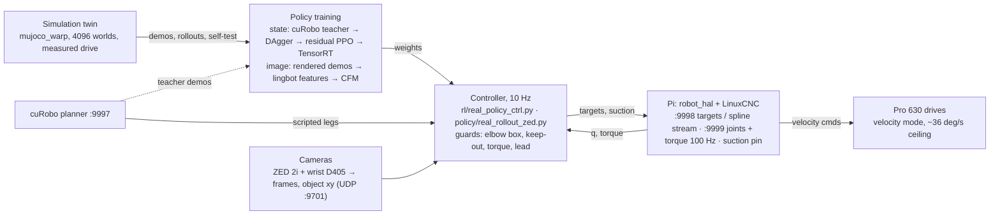
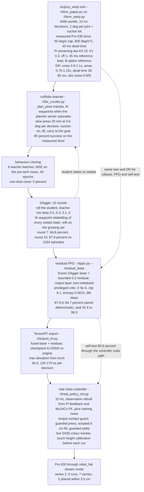
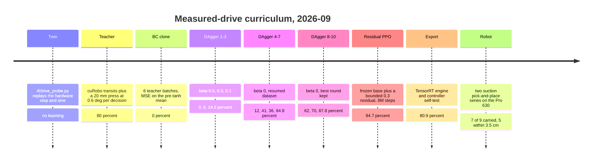

# pick_and_place — myCobot Pro 630 suction pick-and-place

Everything needed to make a **myCobot Pro 630** (6-DOF, suction cup on the flange) pick objects
off a table and place them, from a batched GPU **simulation twin**, through **policy learning**
(cuRobo-taught DAgger + residual PPO on robot state; UMI-style diffusion / flow-matching policies on
camera images), to the **real-robot controllers** that stream to the arm's Raspberry Pi.
Sibling repos supply the planner and the Pi-side controller: `../mycobot_mpc` (robot_hal, joint
conventions, spline reference), `../ros2node` (RealSense/SAM3 nodes),
`../frankkimrobotics/ros2_mycobot/src/mycobot_description` (URDF + cuRobo planner server).

**Status (2026-10-22).** The policy that picks and places on the real arm is the state-based
residual-PPO policy (`rl/weights/resid1_real_best`, `resid3_fast_best`) driven by
`rl/real_policy_ctrl.py` with a camera tracker (series of 2026-09-20: 7 of 9 carried, 5 placed
within 3.5 cm). The image-based line (`policy/train_policy_zed.py`, wrist D405 + fixed ZED 2i,
frozen lingbot-vision features) trains and runs end to end on the robot
(`policy/real_rollout_zed.py`) but has not yet produced a real pick: it reproduces the demo
structure (descend, press, suction, lift, carry to the bin) while pressing at the centroid of the
visible objects instead of on one of them (sim-to-real visual gap; runs of 2026-10-15 in
`~/pnp_real_runs/zed_run1..6`). Three experiment lines are documented in `docs/`: Q-planning on
the twin, wrench-limited extraction, and the Pro 630 hardware limits.

---

## 1. Architecture



Data flow in one sentence: the twin is calibrated against the arm (`rl/drive_probe.py`), demos are
written into it by cuRobo (state line) or by a scripted press-to-seal expert with rendered cameras
(image line), policies are fitted, evaluated closed-loop in the same twin, exported, and streamed
to the Pi at 10 Hz through one controller class (`PiLink` in `rl/real_policy_ctrl.py`).

### Interpreters and environments

| Env / interpreter | Path | Used for |
|---|---|---|
| `mjwarp` | `~/miniconda3/envs/mjwarp/bin/python` (`$PY` below) | everything on the twin: `rl/*`, `dataset_gen*.py`, `sim_taskmpc.py`, `compare_controllers.py`, TensorRT export, `real_policy_ctrl.py` |
| `curobo2` | `~/miniconda3/envs/curobo2/bin/python` | cuRobo planner server (:9997), `sim_robot_mjcf.py` (URDF → MJCF), legacy kinematic sim, nvblox (`~/nvblox`) |
| `ilpolicy` | `~/miniconda3/envs/ilpolicy/bin/python` | image policies: `policy/extract_features.py`, `policy/train_policy*.py`, `policy/real_rollout_zed.py` (torch 2.13, diffusers, lingbot_vision, mujoco) |
| `sam3` | `~/miniconda3/envs/sam3/bin/python` | SAM3 server, `policy/rollout_sim.py`, `convert_litdata.py`, `export_models.py` (Gen A image line) |
| system `python3` (3.8) | `/usr/bin/python3` + `PYTHONPATH=~/librealsense/build/release` | anything that opens a camera: RealSense (`pyrealsense2` build), ZED (`pyzed`), trackers, camera servers, `suction_test.py`; ROS 2 Humble nodes |

Port map: `:9997` cuRobo (desktop) · `:9998` robot_hal commands / stream, `:9999` feedback (Pi) ·
`:9701` object tracker UDP · `:9702` success monitor UDP · `:5599` SAM3 ZMQ · `:9994` legacy
`online_servo` chunk port (retired) · `:8765` ctrl_tuner GUI (mycobot_mpc).

### Repository map

| Path | What lives there | Era |
|---|---|---|
| `rl/` | twin (`env_warp.py`, `env_paper.py`, `env_v2.py`, `env_v3.py`), teachers and DAgger (`bc_curobo.py`), PPO (`ppo.py`), eval, export, real-robot controller, trackers, success monitor, `qplan/`, wrench / seal / DiffOG experiments; `rl/README.md`, `rl/FINDINGS.md` (927 lines of numbered findings), `rl/weights/` | 2026-08 → now, **current** |
| `policy/` | image-policy line: feature extraction, `train_policy_zed.py`, `train_lit.py`, `rollout_sim.py`, real executors (`real_rollout_zed.py`), camera servers; plan documents | 2026-08 → now, **current** |
| `dataset_gen*.py`, `mjwarp_pick_demo.py`, `sim_robot_mjcf.py`, `rim_seal.py`, `cfm_guided.py`, `real_graspability.py`, `spline_action.py` (in `policy/`) | sim demo generators and the primitives they share; MJCF builder | **current** |
| `config.py`, `calib_*.py`, `outputs/extrinsics_*.json` | TCP / hand-eye / fixed-camera calibration | current |
| `sim_taskmpc.py`, `compare_controllers.py`, `pick_place_compare.py`, `render_mpc_demo.py`, `real_ctrl_validate.py`, `touch_planner_compare.py`, `bench_line_vs_curobo.py` | controller studies on the twin and the arm (task-MPC, cuRobo, LQR) | 2026-08/09 |
| `bc_mystery/` | behavioural-cloning-mystery replication harness on the twin | 2026-08 |
| `docs/` | reports (RL, wrench extraction, hardware limits, URDF audit), project pages, session plots | 2026-09/10 |
| `real_touch.py`, `suction_test.py`, `d435_detect.py`, `d435_capture.py` | hardware utilities still in use | current |
| `real_pipeline.py`, `real_multi.py`, `servo_touch.py`, `touch_*.py`, `online_planner_node.py`, `chunk_to_pi.py`, `sim_*_node.py`, `run_demo.py`, `il/`, … | June–July stacks (ROS 2 bridge, `online_servo` chunks, blue-dot contact, kinematic sim, IL v1) — kept for reference, see §9 | legacy |

---

## 2. Quick start — the three things people actually run

```bash
cd ~/Desktop/2026/pick_and_place
PY=~/miniconda3/envs/mjwarp/bin/python
IL=~/miniconda3/envs/ilpolicy/bin/python
RS="PYTHONPATH=$HOME/librealsense/build/release /usr/bin/python3"
```

**A. Simulation: evaluate a state policy on the twin (no robot)**
```bash
$PY rl/env_warp.py --nworld 64 --steps 20                                   # twin smoke test
$PY rl/eval_residual.py rl/weights/resid3_fast_best.pt --nworld 1024 --ep_len 150 --dq_max 3 --base_dq_max 2
$PY rl/real_policy_ctrl.py --policy rl/weights/resid1_real_best --selftest --episodes 256   # controller code path vs twin
```

**B. Real robot: state policy pick-and-place (the working path)**
```bash
ssh pi@192.168.50.2 'bash ~/Desktop/mpc/launch_mpc_stack.sh'        # Pi: LinuxCNC + robot_hal, wait ~60 s for "Waiting for commands"
eval $RS rl/rgb_track.py --mode depth &                               # fixed-camera object tracker -> UDP :9701 (ZED: /usr/bin/python3 rl/zed_track.py)
eval $RS rl/success_monitor.py &                                      # two idle D405s -> UDP :9702
bash rl/run_pick.sh 01                                                # tracker -> bias -> goal -> touch calib -> policy -> verdict
```

**C. Real robot: image policy (ZED + wrist camera)**
```bash
eval $RS policy/zed_cam_server.py --fps 15 &                          # ZED left + wrist D405 -> /dev/shm/pnp_{zed,wrist}.jpg
$IL policy/real_rollout_zed.py --ckpt ~/pnp_policies/cfm_lingbot/ckpt_final.pt --go_home              # dry run (nothing moves)
$IL policy/real_rollout_zed.py --ckpt ~/pnp_policies/cfm_lingbot/ckpt_final.pt --go_home --exec --slow 2
```

Nothing in this repo moves the arm without `--exec`. Always run the 1° joint-1 probe (§3.1)
after a stack launch and before the first policy command.

---

## 3. Bring-up and services

### 3.1 Robot stack on the Pi

The Pi (`pi@192.168.50.2` over the direct cable; `10.0.0.27` is the same Pi on WiFi with 50–125 ms
spikes — do not control over it) boots the vendor RoboFlow stack. Ours replaces it:

```bash
ssh pi@192.168.50.2 'bash ~/Desktop/mpc/launch_mpc_stack.sh'
# = pkill vendor linuxcnc/milltask/rtapi_app/elephantmonitor, rm /tmp/linuxcnc.lock,
#   systemd-run --user --unit=lcnc-mpc linuxcnc ~/Desktop/mpc/elerob.ini  (logs: ~/Desktop/mpc/logs/)
ssh pi@192.168.50.2 'grep -c "Waiting for commands" /tmp/linuxcnc.print.*'   # ready when > 0 (~40-60 s)
```

robot_hal then powers the drives, initialises joints 1–6, enables servo, and listens on `:9998`
(commands: `{"target_deg":[6 lcnc deg],"duration":s,"controller":"pid|mpc"}`; stream chunks and
B-spline references; `{"suction":0|1}`) and `:9999` (joints + torque at ~100 Hz). Known failure:
if `rtapi_app pandakins` "exited without becoming ready" (an error dialog `show_errors.tcl` appears
on the Pi display, `/tmp/linuxcnc.debug.*` says so), the realtime state was stale — run
`pkill -x wish8.6; systemctl --user stop lcnc-mpc; pkill -x linuxcnc...; halrun -U; rm -f /tmp/linuxcnc.lock`
on the Pi and launch again. Never restart `robot_hal.py` alone (its HAL pins come up unlinked and
the PID integral winds up; see `../mycobot_mpc`).

**Probe before any motion** (the stream law must move the arm by the commanded 1°):
```bash
$PY - <<'EOF'
import sys, os, time, numpy as np
R=os.path.expanduser('~/Desktop/2026/pick_and_place'); sys.path[:0]=[R+'/rl',R,os.path.abspath(R+'/../mycobot_mpc')]
from real_policy_ctrl import PiLink, Guard, ObsBuilder, scripted_move
ob=ObsBuilder(R+'/rl/scenes/box_med.xml',[0.025]*3); g=Guard(ob,0.035); L=PiLink('192.168.50.2',True,ref_mode='spline')
t=time.time()
while not L.ok() and time.time()-t<6: time.sleep(0.1)
q0,_,_=L.state(); q1=q0.copy(); q1[0]+=np.radians(1.0)
scripted_move(L,g,ob,q1,'probe +1 deg',v_peak_deg=5.0); print('delta deg',np.round(np.degrees(L.state()[0]-q0),2))
scripted_move(L,g,ob,q0,'probe back',v_peak_deg=5.0); L.close()
EOF
```

Shutdown: send the arm home, then on the Pi `kill -INT <robot_hal pid>` (powers drives off,
brakes engage), `systemctl --user stop lcnc-mpc`, `pkill -x linuxcncsvr milltask rtapi_app`,
`rm -f /tmp/linuxcnc.lock`. Do not leave the arm enabled and raised unattended (servo-enable has
dropped spontaneously; joint-1 torque loss toward the wall behind the robot is an open hardware
item).

### 3.2 Planner and camera services (desktop)

```bash
# cuRobo planner server (needed by bc_curobo.py, calibration, real_touch.py, the scripted legs)
cd ../frankkimrobotics/ros2_mycobot/src/mycobot_description/curobo && \
  ~/miniconda3/envs/curobo2/bin/python curobo_planner_server_v2.py --ground-z -0.1 &

# object trackers (one at a time; both publish the same message on UDP :9701)
eval $RS rl/rgb_track.py --mode depth            # fixed D435 (modes: depth | diff | dark | hue; --once --debug /tmp/t.png)
/usr/bin/python3 rl/zed_track.py                 # fixed ZED 2i, same message; needs the ZED free (stop zed_cam_server first)
eval $RS rl/success_monitor.py                   # fixed D405 + wrist D405 before/after verdict on UDP :9702

# image-policy cameras (ZED left 432x240 + wrist D405 424x240 + decimated ZED XYZ -> /dev/shm)
eval $RS policy/zed_cam_server.py --fps 15
# Gen-A cameras (wrist D405 + fixed D435 -> /dev/shm/pnp_{wrist,fixed}.jpg)   /usr/bin/python3 policy/cam_server.py
# RL student cameras (96x96 RGBD -> /dev/shm/rs_*.npy)                        eval $RS policy/rs_shm_server.py
# SAM3 segmentation server (sam3 env, ZMQ :5599)                               bash ../ros2node/scripts/run_sam3_server.sh

# suction without motion
python3 suction_test.py --on --host 192.168.50.2 ; python3 suction_test.py --off --host 192.168.50.2
```

Only one process can hold a camera; the two D405s share a USB bus (frame rate drops when both
stream); the ZED needs a USB 3 port and the `uvcvideo` module (`sudo modprobe uvcvideo` if
`/dev/video*` is missing — the module is blacklisted for librealsense).

### 3.3 Calibration

| What | Script | Output | Notes |
|---|---|---|---|
| wrist D405 hand-eye `T_TCP_CAM` | `calib_handeye.py [--apply]` (ChArUco views from joint-space samples) | `outputs/handeye_*.json`, patches `config.py` | last replaced 2026-10-13 (previous matrix in `config.py.bak_handeye`); the comment above it in `config.py` is stale |
| fixed D435 extrinsics | `calib_d435.py` (board seen by the wrist D405, planner up) or `calib_cup_sweep.py --exec [--write]` (board-free Kabsch on cup-tip detections) | `outputs/extrinsics_d435.json` (2026-09-20) | mount was rebuilt 2026-08-24; re-run before trusting; `d435_detect.py --board` self-check |
| fixed D405 extrinsics | `calib_fixed_static.py` | `outputs/extrinsics_d405_fixed.json` (2026-06-29) | **stale** (camera bumped; localises ~10 cm off) |
| fixed ZED 2i extrinsics | `/usr/bin/python3 rl/calib_zed_board.py [--search --provisional]` (board-anywhere: wrist-measured board pose + ZED PnP) | `outputs/extrinsics_zed.json` (2026-10-13, `T_base_camzed`) | current |
| tracker bias | `rl/wrist_centre.py` (wrist-D405 circle fit from a 12 cm hover) | `~/pnp_rl/tracker_bias.json` (= raw − true, subtracted by the consumers) | measured for the D435 tracker; not re-measured for the ZED |
| object top height on the robot | `rl/touch_verify.py --xy X Y --z_top Z --exec` / `real_policy_ctrl.py --touch_calib` | — | camera tops read 1–6 cm low on cups |
| TCP length / table | `config.py`: `HANDEYE_TCP_LEN 0.145`, `PLANNER_TCP_LEN 0.135`, `CAM_TCP_Z_SHIFT 0.010`, `TABLE_Z = -0.10` | — | **real table top is z ≈ 0 in the control frame**; `TABLE_Z` is stale, `real_policy_ctrl.py` refuses object tops outside 0.02–0.07 m unless `--force` |

Camera serials: wrist D405 `218622271300`, fixed D405 `218622277013`, fixed D435 `043422070101`,
ZED 2i `30632616` (ZED HD720 left: fx = fy = 523, v_fov 69.1° = the sim camera's `fovy`).

### 3.4 cuRobo v0.9.0 (cuRoboV2-Fast) — installed 2026-11-06, not yet deployed

Upstream tag `v0.9.0` ([research page](https://research.nvidia.com/labs/lpr/curobov2-fast/)) adds B-spline trajectory
optimisation, TimeOpt time-optimisation, a GPU bidirectional RRT and differentiable inverse dynamics, all on by default
in `MotionPlannerCfg.create`. It lives in its own env so the production server (v0.8, `curobo2`, :9997) is untouched:

```bash
# env curobo3 = clone of curobo2 + torch 2.9.1 (cu126; v0.9 needs torch >= 2.7) + ~/Desktop/2026/curobo_v090 (pip install -e ".[cu12]")
cd ../frankkimrobotics/ros2_mycobot/src/mycobot_description/curobo
~/miniconda3/envs/curobo3/bin/python bench_v2fast.py --tag v090_acc8 --max_acc 8 --save_traj   # 12 trials x hover/carry/home on the Pro 630 cell
~/miniconda3/envs/curobo2/bin/python bench_v2fast.py --tag v080_default --no_cuda_graph --save_traj
~/miniconda3/envs/mjwarp/bin/python validate_plans.py ~/pnp_rl/curobo_v2fast/v090_acc8_traj.npz   # elbow box, 36 deg/s, 600 deg/s^2, torque
~/miniconda3/envs/curobo3/bin/python curobo_planner_server_v2.py --ground-z -0.1 --port 9996     # the unchanged server runs under v0.9 as is
```

| | v0.8 (A5000, no CUDA graph) | v0.9.0 (2080 Ti) |
|---|---|---|
| success (hover / carry / home, 12 trials each) | 12/12 everywhere | 12/12 everywhere |
| planning wall time per call | 1.7 s | 22 ms with CUDA graph, 0.7 s without |
| trajectory duration hover / carry / home | 2.0 / 3.5 / 3.0 s | 1.29 / 2.51 / 2.07 s (TimeOpt; same 34 deg/s peak) |
| hardware envelope (`validate_plans.py`) | 0 violations, peak accel 187 deg/s² | with yaml `max_acceleration: 8.0`: 0 violations, peak accel 555 deg/s², torque < 10 % of limits; at the default 10.47 the peaks reach 660 deg/s² |

Findings: v0.8 cannot use CUDA graphs with world updates; the server's `camera_mount_d435` cuboid (0.30 m cube at
x 0.64, the mount no longer exists) blocks every +90 deg-yaw hover pose beyond x 0.38 — model the ZED column instead
(`dims [0.12, 0.12, 0.90] at (0.62, -0.09, 0.35)`). The robot was offline on the day, so only the twin validation
exists; results in `~/pnp_rl/curobo_v2fast/`.

---

## 4. State-policy line (mujoco_warp twin → DAgger → residual PPO → TensorRT → robot)

Full narrative with the pipeline and curriculum diagrams is in §11 (kept verbatim from the
2026-09 write-up); flags and the findings log are in [`rl/README.md`](rl/README.md),
[`rl/FINDINGS.md`](rl/FINDINGS.md), [`rl/weights/README.md`](rl/weights/README.md).

### 4.1 Twin and drive calibration
```bash
$PY rl/env_warp.py --nworld 64 --steps 20                      # smoke test (PickEnv, --drive real|ideal)
$PY rl/env_paper.py --nworld 64 --steps 20                     # PaperPickEnv (the deployed task, 40-D obs under the real drive)
$PY rl/drive_probe.py --drive real                             # 10 deg step + 12 deg 0.5 Hz sine vs the 2026-09-17 hardware numbers
CUDA_VISIBLE_DEVICES=1 $PY rl/validate_drive_update.py --nworld 256   # old vs deployed stream law, A/B on resid1
```
Twin facts: 4096 worlds, 10 Hz decisions (50 × 2 ms substeps), action = 6 joint deltas clamped to
`dq_max` (2° training, 3° for the fast policies) + suction logit, suction = force/torque-capped
compliant attach with peel limits, measured drive: 50 °/s cap, 800 °/s² accel, 45 ms dead time,
K0 10 / K1 0.3 / vff 1 stream law with a 45 ms reference lead; DR on gains, dead time and
observation noise (`--dr`). Scenes in `rl/scenes/` (`box_med.xml` is canonical; `box_med_ped.xml`,
`cyl_med.xml`, `multi4.xml`, `clutter4.xml`, `diverse_v2.xml`, `obstacle_v3.xml`).

### 4.2 Teacher, DAgger, residual PPO, eval
```bash
# cuRobo-planned teacher + DAgger rounds (planner server on :9997 required)
$PY rl/bc_curobo.py --drive real --press_depth 0.02 --press_rate 0.6 --out ~/pnp_rl/dagger_real
$PY rl/bc_curobo.py --drive real --resume ~/pnp_rl/dagger_real --dagger_iters 4 --out ~/pnp_rl/dagger_real   # more rounds
python3 rl/plot_dagger.py ~/pnp_rl/dagger_real --out /tmp/dagger.png
# residual PPO on the frozen DAgger base (resid1), then residual-on-residual at dq_max 3 (resid3_fast)
CUDA_VISIBLE_DEVICES=0 $PY rl/ppo.py --env paper --arch paper --drive real --mode pnp --dr --nworld 4096 --steps 8000000 \
   --residual_base ~/pnp_rl/dagger6_real/bc_iter10.pt --residual_bound 0.3 --critic_priv --out ~/pnp_rl/resid1_real
CUDA_VISIBLE_DEVICES=0 $PY rl/ppo.py --env paper --arch paper --drive real --mode pnp --dr --nworld 4096 --steps 8000000 \
   --rollout 24 --epochs 3 --minibatch 24576 --gamma 0.98 --lam 0.95 --clip 0.1 --ent 0.0015 --lr 5e-5 --target_max 0.3 \
   --scene rl/scenes/box_med.xml --dq_max 3.0 --obs_lag -1 --hover 0.02 0.04 --init_std -1.0 --descend_sigma 0.07 \
   --max_grad_norm 1.0 --critic_warmup 8 --lr_max 1e-3 --grasp_shaping 1 --obs_ee 1 --reach_target grasp --lift_dense 1 \
   --w_track_c 4 --w_track_f 8 --w_reach 0.5 --vf_coef 0.5 --reg_ramp 0.4 --ep_len 150 --start home \
   --residual_base ~/pnp_rl/resid1_real/best.pt --residual_bound 0.3 --base_scale 0.6667 --w_time 0.5 --w_speed 1.0 --v_soft 32 \
   --critic_priv --out ~/pnp_rl/resid3_fast
# evaluation on the twin
CUDA_VISIBLE_DEVICES=1 $PY rl/eval_residual.py ~/pnp_rl/resid3_fast/best.pt --nworld 1024 --ep_len 150 --dq_max 3 --base_dq_max 2
CUDA_VISIBLE_DEVICES=1 $PY rl/eval_speed.py --ckpt ~/pnp_rl/resid1_real/best.pt --base ~/pnp_rl/dagger6_real/bc_iter10.pt
$PY rl/demo_video.py --actor rl/weights/resid1_real_best.pt --algo ppo --mode pnp --env paper     # rollout video
python3 rl/plot_training.py ~/pnp_rl/resid3_fast                                               # log.jsonl dashboard
```
Legacy curricula (`ppo.py --mode attach|pnp|mix`, `bc_bootstrap.py`, `bc_paper.py`, `sac.py`,
`distill.py` to an RGBD student, `eval_bench.py` V1–V3 ladder) are described in `rl/README.md`.

### 4.3 Export and self-test
```bash
CUDA_VISIBLE_DEVICES=0 $PY rl/export_trt.py rl/weights/resid3_fast_best.pt --obs_dim 40 --arch paper --out rl/weights/resid3_fast_best   # -> .onnx .plan .json
$PY rl/real_policy_ctrl.py --policy rl/weights/resid3_fast_best --selftest --episodes 256 --dq_max 3.0   # closed loop through the controller code (80-98 %)
```
TensorRT engines are GPU-specific: build them on the GPU the controller runs on (`tensorrt-cu12`
on driver 570, not TRT 11 / cu13).

### 4.4 On the robot
```bash
bash rl/run_pick.sh 01 [goal_x goal_y]    # resid1_real_best, dq_max 2.0 (tracker -> bias -> goal -> monitor snap -> controller -> verdict)
bash rl/run_pick_rand.sh 02               # resid3_fast_best, dq_max 3.0, random tracker candidate
$PY rl/real_policy_ctrl.py --obj 0.38 0.0 0.025 --half 0.04 0.04 0.025 --goal 0.30 -0.12 0.15 --touch_only --exec   # manual, touch-only demo
$PY rl/real_policy_ctrl.py --policy rl/weights/qplan_v1 --dq_max 3.0 ...                                            # Q-planner engine (same controller)
```
Controller facts (`rl/real_policy_ctrl.py`): 10 Hz, observation rebuilt from Pi feedback + MuJoCo
FK of `rl/scenes/box_med.xml`, training obs noise 0.005 added (the clone stalls without it),
per-decision delta ≤ `--dq_max`, reference lead ≤ 3°, elbow box |j2| ≤ 70° |j3| ≤ 145°, wall
keep-out (tip x ≥ 0.12), torque contact guard (firm 0.08 / hard 0.13 / abort 0.25 on the J2+0.5·J3
rise), guarded press to 0.11, attach after 1 s of contact with suction, scripted 8 cm lift, tracker
frozen within 15 cm vertically, guarded settle before release, always home; SIGINT = suction off +
stop streaming. Known policy quirk (2026-10-13): a systematic +3.9 cm +Y descent offset on the
dagger6 policy — pre-compensate `obj_y -= 0.039`.

### 4.5 v2 / v3 (diverse objects, obstacles) and Q-planning
```bash
$PY rl/build_scene_v2.py [--n_dist 3]                     # -> rl/scenes/diverse_v2.xml | obstacle_v3.xml
$PY rl/test_env_v2.py [--skip_teacher]; CUDA_VISIBLE_DEVICES=0 $PY rl/test_env_v3.py
CUDA_VISIBLE_DEVICES=0 $PY rl/bc_curobo.py --env v3 --drive real --nworld 128 --teacher_batches 8 --dagger_iters 4 --dagger_batches 3 \
   --press_depth 0.02 --ep_len 200 --epochs 40 --init ~/pnp_rl/dagger_v2c/bc_iter16.pt --out ~/pnp_rl/dagger_v3
CUDA_VISIBLE_DEVICES=0 $PY rl/eval_v3.py ~/pnp_rl/dagger_v3/best.pt ~/pnp_rl/resid_v3b/best.pt --nworld 1024 --ep_len 200 --out ~/pnp_rl/v3_eval.json
CUDA_VISIBLE_DEVICES=0 $PY rl/export_trt.py rl/weights/resid_v3_best.pt --obs_dim 54 --arch paper --out rl/weights/resid_v3_best
# Q-planning (rl/qplan/README.md): frozen pi = resid3_fast_best, HL-Gauss critic over action chunks, planner exported as one TRT graph
CUDA_VISIBLE_DEVICES=1 $PY rl/qplan/collect.py --nworld 4096 --batches 2 --mode pi --tag m0 --seed 0
CUDA_VISIBLE_DEVICES=1 $PY rl/qplan/critic.py --data ~/pnp_rl/qplan/data --steps 20000 --sep_speed --out ~/pnp_rl/qplan/q1sep
CUDA_VISIBLE_DEVICES=1 $PY rl/qplan/planner.py --eval --q ~/pnp_rl/qplan/q1sep/q.pt --nworld 1024 --which final --sp_margin_pick 0.4 --ema 0.7 --hash_tab rl/weights/qplan_v1_hash.pt
CUDA_VISIBLE_DEVICES=1 $PY rl/qplan/iterate.py --iters 6 --q ~/pnp_rl/qplan/q0b/q.pt --data ~/pnp_rl/qplan/data --q_steps 20000 --fresh --out ~/pnp_rl/qplan/v5
CUDA_VISIBLE_DEVICES=0 $PY rl/qplan/export.py --out rl/weights/qplan_v1 --speed_margin 0.4 --ema 0.7
```
Status: v2 student plateaus at ~46 % (teacher-bound); v3 residual 50.7 % on the twin, no 54-D
observation builder in the real controller yet; Q-planner +1.8 pp / −0.6 s offline, iteration
plateaus at iter 0, 98.0 % self-test at 266 µs/call.

---

## 5. Image-policy line (sim demos with rendered cameras → frozen features → DP/CFM/ACT → robot)

Two generations share `sim_robot_mjcf.py` (MJCF) and `mjwarp_pick_demo.py` (press-to-seal expert
primitives, `Q_START`, `R_DOWN`, IK, `CUP_R 0.008`, `PRESS_M 0.015`, seal check), which every
`dataset_gen*.py` `exec()`s at import.

| | Gen A (2026-08, committed) | Gen B — ZED (2026-10, current, mostly uncommitted) |
|---|---|---|
| scenes | `dataset_gen.py` → `~/pnp_dataset` (600 scenes; wrist D405 + fixed D435 renders) | `dataset_gen_zed.py` + `_funnel` / `_div` / `_dr` / `_ycb` → `~/pnp_dataset_zed` (830 scenes; fixed camera = sim ZED at the calibrated real pose, `fovy 69.1`) |
| features | `policy/extract_features.py --enc clip\|dinov2\|lingbot` (wrist mp4 → `<enc>_tokens.npz`) + `policy/prep_eef.py` (FK → `eef.npz`) | `PNP_DS=<dir> $IL policy/extract_features_zed.py --enc lingbot [--tokens]` → `lingbot_pool.npy` + `lingbot_zed_pool.npy` (mean patch tokens for wrist **and** ZED; identical to the stored features) + `PNP_DS=<dir> $PY policy/prep_eef.py` |
| training | `policy/convert_litdata.py` → `~/pnp_litdata`; `policy/train_lit.py --model dp\|cfm\|act --action q\|eef` (CLIP ViT fine-tuned, DiT, goal token, 16 B-spline joint control points) on Lightning AI → `~/pnp_runs_studio/` | `PNP_DS=~/pnp_dataset_zed $IL policy/train_policy_zed.py --model cfm --enc lingbot --arch unet\|dit\|mlp [--goal] [--graspability] [--action waypoint\|bspline] [--dr] [--tag T]` → `~/pnp_policies/<model>_<enc>[_<arch>][_w<width>][_<tag>]/ckpt_final.pt`; UMI interface: 2 obs frames × 2 cameras + relative EE pose (pos3 + rot6d + suction), 16-step relative EE actions at 10 Hz |
| sim eval | `MUJOCO_GL=osmesa ~/miniconda3/envs/sam3/bin/python policy/rollout_sim.py --ckpt ~/pnp_runs_studio/dp_q/ckpt_final.pt --scene 700 --out ~/pnp_rollouts` (1 kHz PD, C2 bridge / `--abrefit`, suction hysteresis; `--array` 3×3 block test) | `$IL policy/rollout_sim_zed.py --ckpt ~/pnp_policies/<run>/ckpt_final.pt --scenes 10 --seed0 5000 --render` (unseen `dataset_gen_div` scenes, rendered cameras in the loop, physics seal check; writes `~/pnp_rollouts_zed/<run>/metrics.json` + mp4). First numbers 2026-10-26, DP on the real-sensor data: 3/10 sealed, 1/10 placed, press centring error median 3.6 cm |
| export | `~/miniconda3/envs/sam3/bin/python policy/export_models.py --ckpt ... --out ~/pnp_export` (TorchScript / ONNX / TRT) | in-process torch (DiT 90 ms, UNet 300 ms, MLP 45 ms per chunk on the A5000) |
| robot | `/usr/bin/python3 policy/cam_server.py` + `policy/real_rollout.py --ckpt ... --goal_xyz X Y Z [--exec]` (legacy `:9994` transport) | `policy/zed_cam_server.py` + `$IL policy/real_rollout_zed.py --ckpt ... [--goal X Y Z --place_xy X Y] --go_home --exec --slow 2` (robot_hal `:9998`, logs `~/pnp_real_runs/zed_*`) |

### 5.1 cuRobo-planned expert demos into a runtime-placed box (`dataset_gen_curobo.py`, 2026-11-06)

Clears a cluttered table (YCB meshes + primitives) into a **25 cm cube box** at a run-time position with
cuRobo v0.9 planning every transit: the box walls, every other object (inflated cuboids), the table slab
and the ZED column are planner obstacles, and the carried object is attached to the planner's tool for
the carry. Each object gets `--attempts` tries, re-observed before each.

**Suction model (2026-11-06).** The pump runs *before* contact, as on the real cell: the valve opens
`--suction_on_dist` (5 cm) above the object top, and from then on every 4 ms tick asks whether the cup
seals **now** -- contact with the target, approach within `SEAL_DEG` of face-on, and `rim_seal.py`
flatness under the 7.5 mm lip. While the pump runs, whatever is under the lip is pulled onto it
(`--snap_force`) and drawn onto the cup axis (`--center_force` within `--capture_r`), so a light object is
captured instead of being shoved away. The lip itself is compliant and grippy (`priority=1`,
`solref="0.04 1.4"`, `friction 1.8`): a rigid tip delivered a ~30 N spike on first touch that launched
curved objects, the compliant one gives **0.1-0.4 N at 5-15 mm penetration** (measured). The descent
therefore only needs `--press` (1 cm), not the old 15 mm press-to-seal stroke, and the latch ends it.

Two bugs this surfaced, both fixed: `rim_seal` ray-casts are contype-blind, so the centre ray hit the
robot's own suction-cup **visual** mesh ~3.5 mm above the lip and the seal test compared the object
against the gripper (now the generator puts robot visuals in geom group 3 and `rim_seal` takes a
`geomgroup` mask -- `dataset_gen_ycb.py` has the same latent flaw); and the failure taxonomy lumped
weak/tilted contacts into `no_rim_seal` (now `no_contact`, `no_rim_seal`, `tilted`, `weak_contact`,
`pushed`, `touched_other`).

| press-end seal (rigid lip, 15 mm press) | live suction (compliant lip, latch on touch) |
|---|---|
| 10 / 22 objects cleared, 34 attempts | **19 / 25 cleared, 31 attempts** |
| latch force ~30 N (impact spike) | latch force median **0.28 N** |
| object shoved median ~2 mm, up to 32 mm | shoved median **0.2 mm** |
| failures: pushed 9, no_rim_seal 8 | failures: no_rim_seal 7 (lego studs, golf ball), weak_contact 1 |

A running cup therefore rarely pushes anything: at the default 4 mm aim error nothing was pushed away,
and at a 15 mm aim error (`--obs_noise 0.015`) the failures are `no_rim_seal` (lip overhangs the edge)
and `no_contact` (missed), not shoving. Curvature remains the dominant real failure: stacked cups
(rim gap 17-54 mm), lego studs (2-7 mm) and a grazed golf ball never seal.

```bash
# planner server with v0.9 (table slab + ZED column are sent by the generator; cache for up to 32 cuboids)
cd ../frankkimrobotics/ros2_mycobot/src/mycobot_description/curobo
CUDA_VISIBLE_DEVICES=1 ~/miniconda3/envs/curobo3/bin/python curobo_planner_server_v2.py --ground-z -0.1 --port 9996 --collision-cache 32 &
cd ~/Desktop/2026/pick_and_place
MUJOCO_GL=osmesa $PY dataset_gen_curobo.py --count 10 --box 0.30 0.34 --out ~/pnp_dataset_curobo      # fixed box position
MUJOCO_GL=osmesa $PY dataset_gen_curobo.py --count 10 --box_range 0.24 0.36 0.33 0.42 --out ~/pnp_dataset_curobo   # random box per scene
```

Knobs for failure diversity: `--obs_noise` (aim error), `--snap_force` / `--center_force` / `--capture_r`
(how strongly a running cup captures), `--press`, `--touch_n`, `--attempts`. 0 box contacts in any scene;
~3-6 min per scene single-process (0.65 s per plan without CUDA graphs in the server).

`real_rollout_zed.py` safety and behaviour: receding horizon (`--n_exec 8` of 16 actions, inference
in a background thread, actions are absolute targets at observation time), damped-least-squares IK
seeded at the last command with LinuxCNC soft limits as joint bounds, `--orient yawlock` (predicted
tilt, demo yaw locked — the relative rotations random-walk the wrist yaw otherwise), cartesian step
≤ `--step_max 0.02` m and joint step ≤ `--dq_max 3`° per decision, `--slow` time stretch, tip
z ≥ `--z_floor`, tip x ≥ `--x_min 0.05`, torque guard (hard contact blocks further descent, abort
0.25), suction predictions honoured only below `--suction_z 0.09`, homing through a fresh link with
motion verification (robot_hal drops a path sent within ~3 s of a stream's end).

Result so far (2026-10-15, `~/pnp_real_runs/zed_run1..6`): every run descends to the centroid of
the visible objects, presses bare table there, and carries nothing to the sim bin location
(0.10, 0.40). Pooled-feature similarity sim/real is 0.36 (ZED) / 0.52 (wrist). The `_dr` / `_ycb`
generators, the goal conditioning and the graspability head (`train_policy_zed.py --goal
--graspability`, `real_graspability.py` on the ZED XYZ map, `cfm_guided.py` ESDF-guided sampling)
are the responses to that; none has been validated on the robot yet.

---

## 6. Which evaluator for what

| You have | Evaluate with | Metric |
|---|---|---|
| state policy `.pt` (37/40/47/54-D obs) | `rl/eval_residual.py` (paired base vs residual), `rl/eval_v3.py` (obstacles), `rl/eval_speed.py` (peak joint speed), `rl/eval_bench.py` (V1–V3 ladder, legacy ckpts) | success %, seal %, placement error, t_goal, peak |qd| |
| exported `.plan` | `rl/real_policy_ctrl.py --selftest --episodes N` | success through the real controller code path |
| Q-planner | `rl/qplan/planner.py --eval`, `rl/qplan/diag.py` | success, speed, per-chunk Q |
| Gen-A image policy (`train_lit`) | `policy/rollout_sim.py` | sealed / binned per scene, `rollout.mp4` |
| Gen-B image policy (`train_policy_zed`) | `policy/rollout_sim_zed.py` | sealed / lifted / placed per scene, press centring error, mp4 |
| controllers (task-MPC, cuRobo, pinv) | `compare_controllers.py`, `pick_place_compare.py`, `bench_line_vs_curobo.py`, `rl/rl_vs_planner.py` | RMSE / time / tilt, success |
| drive model | `rl/drive_probe.py`, `rl/validate_drive_update.py`, `real_ctrl_validate.py --exec` (robot) | step onset / rise / settle vs hardware |

---

## 7. Other experiment lines (all `$PY`, outputs under `~/pnp_rl/`)

```bash
# wrench-limited extraction from a packed 3x3 array (docs/report-wrench-extraction.md)
$PY rl/wrench_extract.py --smoke | --bc | --train --nworld 512 --variants 4 --steps 4000000 | --eval --scenes 6 --render
$PY rl/wrench_showcase.py --scenes 6 --seed0 200 ;  $PY rl/real_wrench_ctrl.py --obj X Y Zc --half hx hy hz --goal GX GY --touch_only --exec
# seal physics / contact-phase RL (rim_seal.py rim-flatness model; seal_env needs ~/pnp_rl/seal_scene_bank/meta.json)
$PY rl/seal_probe.py --drive both --rate 1.0 ;  $PY rl/seal_sac.py --steps 150000 --out ~/pnp_rl/seal_sac1 --gpu 1
# differentiable trajectory-optimisation layer (DiffOG-style)
$PY rl/diffog_layer.py --test ;  $PY rl/diffog_pnp.py --make_data --episodes 40 | --train | --eval --episodes 8 --render
# planner limit sweeps and the RL-vs-planner A/B
$PY rl/planner_sweep.py ;  $PY rl/planner_touch.py --obj X Y Z --exec ;  $PY rl/rl_vs_planner.py --base ... --residual ...
```
Controller studies on the twin (`sim_taskmpc.py`, `compare_controllers.py`, `pick_place_compare.py`)
and the BC-mystery harness are in §12 and §13.

---

## 8. Checkpoints

`rl/weights/` (state policies; each deployable stem has `.pt` + `.onnx` + `.plan` + `.json`):

| Stem | What | Twin result |
|---|---|---|
| `dagger6_real_iter10` | pure DAgger round 10 (controller default `--policy`) | 87.8 % |
| `resid1_real_best` | residual PPO on dagger6 (`run_pick.sh`) | 94.7–95.3 % |
| `resid3_fast_best` | residual-on-residual at `--dq_max 3` (`run_pick_rand.sh`, Q-planner base) | 96.4 %, t_goal 7.8 s |
| `resid_v3_best` | 54-D ObstacleEnv residual | 50.7 % |
| `qplan_v1` (+ `_critic.pt`, `_hash.pt`) | whole Q-planner as one TRT graph | 98.0 % self-test |
| `paper12_ideal_best`, `paper14_real_best`, `dagger5_real_iter{5,7}` | ideal-drive PPO control, demo-anchored PPO, earlier DAgger rounds | 83.1 % / 24 % / 84.8 % |
| `ppo4_pnp_table`, `ppo5_workspace`, `ppo7_ped_teacher`, `ppo15_attach_fixedphys`, `distill1_student_rgbd` | legacy 37-D era (table targets, workspace grid, pedestal teacher, attach, RGBD student) | see `rl/weights/README.md` |

`~/pnp_policies/` (image policies, Gen B, 2026-10-14…17): `cfm_lingbot` (UNet, the one to use
on the robot), `cfm_lingbot_dit`, `cfm_lingbot_mlp`, `cfm_lingbot_mlp_w4096`, `cfm_lingbot_funnel`,
`cfm_lingbot_goaldiv`, `cfm_lingbot_goaldr`, `cfm_lingbot_bspline`, `cfm_lingbot_wpfix`,
`cfm_lingbot_ycbgrasp`, `dp_lingbot_goaldiv`, `act_lingbot_goaldiv` (val loss ≈ 0.005 for
unet/dit, 0.009 mlp); `dp_lingbot_real200` / `dp_lingbot_all1050` (2026-10-25, DP on the fresh
real-sensor data `~/pnp_dataset_dp` alone / merged with the 850 good ZED scenes). Gen A exports live in `~/pnp_export/{dp,cfm,act}_final`.

---

## 9. Known stale items and gaps (as of 2026-10-22)

- **Uncommitted current work**: `dataset_gen_{zed,funnel,div,dr,ycb}.py`, `policy/{train_policy_zed,real_rollout_zed,spline_action,zed_cam_server}.py`, `rim_seal.py`, `real_graspability.py`, `cfm_guided.py`, `rl/{seal_env,seal_sac,diffog_layer,diffog_pnp,real_wrench_ctrl}.py`; modified `config.py` (hand-eye), `sim_robot_mjcf.py` (plunger cup), `policy/rollout_sim.py`, `policy/train_lit.py`. Stray backups: `*.bak_*`, `policy/zed_cam_server.py.bak`.
- Missing scripts: a generator for `~/pnp_rl/seal_scene_bank`. (The ZED feature extractor and the Gen-B simulator evaluator were added 2026-10-25/26: `policy/extract_features_zed.py`, `policy/rollout_sim_zed.py`.)
- Hard-coded `~/pnp_dataset` in `prep_eef.py`, `extract_features.py`, `convert_litdata.py`, `train_policy.py`, `postprocess_picks.py`; only `train_policy_zed.py` honours `PNP_DS`.
- `rl/weights/README.md` omits `dagger5_real_iter5`, `resid_v3_best`, `qplan_v1*` and still names `dagger5_real_iter7.plan` as the controller's engine; `real_policy_ctrl.py` keeps `DQ_MAX_DEG = 2.0` (pass `--dq_max 3.0` for resid3/qplan) and its docstring cites `d435_track.py` (use `rgb_track.py` / `zed_track.py`).
- `config.py`: `TABLE_Z = -0.10` is stale (table z ≈ 0), the hand-eye comment is stale; `outputs/extrinsics_d405_fixed.json` is stale; `outputs/current_architecture.md` describes the July `online_servo` stack (retired).
- Pi address drift: Gen-A / legacy scripts default to `10.0.0.27` (WiFi); use `192.168.50.2`.
- `rl/scenes/clutter4.xml` and `rl/_scene_rl.xml` carry absolute `meshdir` paths.
- `rl/README.md` (2026-09-20) predates v3, Q-planning, wrench, seal and DiffOG; `docs/report-*.md` cover the latter two.

---

## 10. Legacy stacks (June–July 2026), one paragraph each

- **ROS 2 bridge pick-and-place** (`real_pipeline.py`, `real_multi.py`, `real_grasp.py`, `real_place.py`, `robot_execute.py`, `sim_*_node.py`, `sim_launch.sh`): per-command moves over `/mycobot/cmd/move` through `mycobot_ros2_bridge.py`, SAM3 "everything" segmentation, ~0.8 s command lag. Superseded by the streaming stack.
- **Online chunk streaming** (`online_planner_node.py`, `chunk_to_pi.py`, `traj_weld.py`, `robot_weld_controller.py`, Pi `online_servo.py` on `:9994`; `online_planner_design.md`, `outputs/current_architecture.md`): 4 ms welded chunks. Replaced in September by robot_hal stream mode with the B-spline reference on `:9998`; `online_servo` is dangerous (servo loop runs before the drives enable).
- **Touch / contact research** (`servo_touch.py`, `touch_*.py`, `torque_touch.py`, `table_touch*.py`, `visual_servo_touch.py`, `contact_detector.py`, `TOUCH_METHODS.md`): open-loop touch and the J2/J3 torque rise are what survived; depth gap is proximity only (+41 mm), the blue-dot method is unreliable, vision contact is impossible (cup sits in the D405 near-field blind spot).
- **Kinematic simulation** (`run_demo.py`, `pipeline.py`, `simulator.py`, `scene.py`, `mujoco_export.py`, `run_mujoco.sh`): robot-off trimesh sim with cuRobo plans and a MuJoCo replay; `python -m pick_and_place.run_demo --place-mode planned` from `~/Desktop/2026`.
- **IL v1** (`il/`, `imitation_learning_plan.md`, `pnp_collect.py`, `episode_bag.py`): rosbag episodes, four heads (umi / diffusion / cfm / drift) on 96 px images, joint-space absolute actions. Nothing downstream imports it.
- **Latency studies** (`latency_common.py`, `step_response.py`, `step_id.py`, `weld_response_test.py`, `cross_weld_test.py`, `taskA_*.py`, `taskC_*.py`): dead-time / lag identification that fed the drive model; `docs/report-hardware-limits.md` is the current summary.

## 11. State-policy training procedure in detail (2026-09, kept verbatim)

The policy that picks and places on the real arm today is **not** PPO from scratch. It is a
student cloned from a cuRobo-based scripted expert, corrected by **DAgger**, then fine-tuned by a
**bounded residual PPO**, all inside the `mujoco_warp` twin running a **hardware-calibrated Pro 630
drive model**. The planner produces data only — at run time the fused network is the only thing
that runs. Every number below comes from [`rl/FINDINGS.md`](rl/FINDINGS.md) (items 1–22); the
training flags live in [`rl/README.md`](rl/README.md) and the checkpoints in
[`rl/weights/README.md`](rl/weights/README.md).

### Pipeline



In words: the twin is calibrated against the arm, the planner writes demonstrations into
it, the network is fitted to those demonstrations and then to its own mistakes, PPO adds a small
bounded correction, and the result is compiled and streamed to the Pi.

### Curriculum and schedule



| # | Stage | What is trained | Data / teacher | Objective | Steps or rounds | Metric at the end |
|---|---|---|---|---|---|---|
| 0 | Twin calibration | nothing | hardware step + sine replay (`rl/drive_probe.py`) | — | — | sim 10° step onset 60 ms / rise 0.24 s / settle 0.43 s vs hardware 36–52 ms / 0.27 s / 0.43 s; 12° 0.5 Hz sine rms 0.12° vs 0.10–0.12° |
| 1 | Scripted expert | nothing | `rl/bc_curobo.py`: cuRobo `plan_pose` transits + scripted press | — | 6 teacher batches | **80 %** teacher success on the measured drive (press-depth sweep: 4 mm 3 %, 8 mm 65 %, 12 mm 80 %, **20 mm 91 %**) |
| 2 | Behaviour cloning | actor `pi` | the teacher batches | MSE on `mu = atanh(a)` (pre-tanh space) | 40 epochs | **0 %** — the seal basin is too narrow for a one-shot clone |
| 3 | DAgger rounds 1–3 | actor `pi` | student rollouts relabelled by the teacher | same MSE on the growing set | 3 rounds, β 0.5 / 0.3 / 0.1 | **14.5 %** deterministic (`dagger4_real`) |
| 4 | DAgger rounds 4–7 | actor `pi` | `bc_curobo.py --resume`, β 0 relabels | same | 4 rounds | **84.8 %** (`dagger5_real_iter7.pt`) |
| 5 | DAgger rounds 8–10 | actor `pi` | continued rounds, keep the best-scoring one | same | 3 rounds, ≈1.4 M states | **87.8 %** on 1024 episodes (`dagger6_real_iter10.pt`) |
| 6 | Residual PPO | a second actor only | on-policy rollouts in the same twin | PPO clipped surrogate on the paper reward below; executed action `clip(base + 0.3·tanh(r))`, residual zero-initialised, critic from scratch with 5 privileged dims, 8 critic-only warm-up updates, demo anchor decaying 1.0 → 0.1 | 8 M steps, 4096 worlds, γ 0.98, 3 epochs, minibatch 24576 | **94.7 %** paired deterministic, seal 96.5 %, residual magnitude ≈0.02, no decay (`resid1_real_best.pt`) |
| 7 | Export + self-test | nothing | — | — | — | engine vs torch 3e-5; closed loop through the controller **80.9 %** vs 78 % direct |
| 8 | Real robot | nothing | — | — | 2 series, 19 runs | series 1: 5 of 10 full pick-and-place; series 2: 7 of 9 carried, **5 placed within 3.5 cm** |

The ideal-drive line is kept as a control, not as a deployment path: plain PPO with the same
recipe reaches **83.1 %** there (`paper12_ideal_best.pt`) but scores **1–2 %** in the
measured-drive env (see "why" below).

**Domain randomisation** (`--dr`, `rl/env_warp.py DRIVE_DR`):

| knob | range |
|---|---|
| drive velocity cap | 50 °/s × U(0.9, 1.1) |
| drive acceleration cap | 800 °/s² × U(0.75, 1.15) |
| command → motion dead time | U(30, 65) ms (nominal 45 ms) |
| observation noise | Gaussian σ **0.005** — also required at test time, see below |
| PD gain scale, seal tolerance | per-world jitter |
| action latency | the legacy 100 ms action-delay DR is **off** under `--drive real`; the drive model already carries the real latency |

**Reward of the paper-style env** (`rl/env_paper.py`; weights are the working recipe, the paper's
own values in brackets where they differ):

| term | form | weight |
|---|---|---|
| `reach` | `1 − tanh(d_tcp→grasp / 0.25 m)`, measured to the **grasp point** (top centre + cup radius), not the object centre | 0.5 [1] |
| `lift` | dense ramp to `h_min` = 2 cm, equal to the paper's indicator at and above it | 2 |
| `track_c` | gated on lifted, `1 − tanh(d_goal / 0.10 m)` | 4 [2] |
| `track_f` | gated on lifted, `1 − tanh(d_goal / 0.02 m)` | 8 [4] |
| `press` | dense credit for a sustained press into the top (embodiment fix: a suction cup has no "close the gripper") | 0.5 |
| `seal` | one-time latch bonus | 2 |
| `reg_act`, `reg_vel` | `−λ(t)·(‖Δa‖² + ‖q̇‖²)`, λ ramps to 0.02 | `--reg_ramp 0.4` |
| `fail` | object off the table | −1 |
| `speed` | hinge `−w · Σⱼ relu(abs(q̇ⱼ) − 30 °/s) / 30` and the same on acceleration above 400 °/s² — not in the paper, it keeps the motion inside the 36 °/s following-error ceiling | 0 by default; 0.5 / 0.2 in the speed run |
| `time` | flat cost per decision until the object is lifted **and** at the goal — makes *finishing* pay | 0 by default; on in the speed retraining |

Success = object lifted and within `--succ_tol` 3.5 cm of the goal at the 150-decision limit.

### Why the pipeline looks like this

Three negative results shaped it, and each is expensive to rediscover:

- **Plain PPO from a DAgger init decays on the measured drive.** `paper13/14_real` peaked at
  ≤ 24 % and fell back; even the demonstration anchor (`--bc_data --critic_warmup`) did not fix it.
  The on-policy updates destroy the narrow press behaviour. A *bounded, zero-initialised* residual
  cannot: training starts exactly at 87.9 % and the base is frozen.
- **Cross-drive transfer fails.** An 89.8 % ideal-drive checkpoint scores 1–2 % in the
  measured-drive env *even at zero dead time and 5× acceleration* — the streamed outer law, the
  100 ms ramps, the velocity ceiling and the delayed feedback remain. Each drive needs its own
  policy trained under its own dynamics, which is why the twin must match the drive.
- **The clone needs its training observation noise at test time.** Nominal sim, no noise: 31 %;
  with the env's 0.005 Gaussian noise: 78 %; full DR: 85 %. Deterministic observations let the
  clone stall at a fixed point. `real_policy_ctrl.py --obs_noise 0.005` is the default on the robot.

### Deployment on the real arm

Safety rules, port map and the object-height precondition are documented once in
[`rl/README.md`](rl/README.md#deploying-a-policy-on-the-real-pro-630-2026-09-19) and the bring-up
sequence in [Real robot — complete start procedure](#14-real-robot--complete-start-procedure-2026-08-write-up-addresses-updated) below —
they are not repeated here. In short: nothing is sent without `--exec`, the per-decision delta is
≤ 2°, the streamed reference may lead the measured joint by ≤ 3°, the elbow box and wall keep-out
are enforced on every decision, a torque contact guard holds at "firm" and aborts at "hard", and
SIGINT drops suction and stops streaming.

```bash
PY=~/miniconda3/envs/mjwarp/bin/python

# 1. export the current policy (fused base + residual) -> ONNX + TensorRT engine
$PY rl/export_trt.py rl/weights/resid1_real_best.pt --obs_dim 40 --out rl/weights/resid1_real_best

# 2. self-test the controller path against the twin (no robot, same observation code)
$PY rl/real_policy_ctrl.py --policy rl/weights/resid1_real_best --selftest --episodes 16

# 3. live object tracker on the fixed D435 (Lab distance from the table colour) -> UDP :9701
PYTHONPATH=~/librealsense/build/release python3 rl/rgb_track.py --mode diff --top 0.098

# 4. one pick-and-place run: tracker xy, touch height calibration, random goal
bash rl/run_pick.sh 01              # or: bash rl/run_pick.sh 01 <goal_x> <goal_y>
```

`rl/run_pick.sh` reads the tracker, subtracts the measured tracker bias
(`~/pnp_rl/tracker_bias.json`, +0.7 / −16.9 mm), picks a goal, then runs
`real_policy_ctrl.py --track --touch_calib --go_home --exec` and asks the success monitor on
UDP :9702 for a verdict. Controller behaviour that the two robot series forced in (all in
`rl/real_policy_ctrl.py`, FINDINGS 20–22):

- **guarded press** — vertical 2 cm/s until the contact metric reaches 0.11, never more than 15 mm
  below the calibrated top, then a 0.5 s dwell with suction on;
- **touch height calibration** before every run — camera tops read 1–6 cm low on cups;
- **attach** = contact for `ATTACH_AFTER` with suction on, by torque **or** by position **or** by
  lift-after-press, followed by a **scripted 8 cm lift** (the policy's post-attach press is
  unreliable off its trained height);
- **tracking frozen** once the cup is within 15 cm vertically — the arm's shadow shifts the blob;
- **flat hold chunks**, a carry-phase action filter for the 5 Hz dither, a **guarded settle**
  before release, and always retract + home;
- all scripted legs are **min-jerk** paths at a 25 °/s peak that wait on feedback instead of a
  blind pad, with a `[timeline]` line and a `.phases.json` written per run (35–45 s runs should
  land at 20–25 s; the policy itself is ~8 s of that).

### Results on the robot, 2026-09-20

| series | runs | outcome |
|---|---|---|
| touch-only demos | 6 | touch at 5.1 s at full training speed, 3.9 s on a 10 cm object outside the trained 2–7 cm range, 6.1 s at x = 0.26 near the base — generalises in height and position without retraining |
| suction series 1 | 10 | **5 full pick-and-place**, placed 1.0–5.5 cm from the goal; failures were controller shakedown, a sloped top and a 2 cm thin object |
| suction series 2 | 9 | **7 carries, 5 placed within 3.5 cm**, 2 set down ~6 cm off, 1 tipped on release before the guarded settle existed; 2 failures on an open-top cup |

Known hardware nuisances from these sessions: the Pi's `:9999` feedback broadcaster died silently
four times (command port `:9998` kept answering) — relaunch the stack; and after one relaunch
joint 6 stopped responding with status word 0x8637, the August "deaf drive" signature.

---

## 12. Controllers & sim twin (2026-08)

Three control stacks, all validated on the MuJoCo twin (`rl/scenes/*.xml`,
same model the RL trains on) with an emulated drive layer that reproduces the
real arm's velocity-mode servo behavior. Environment for all sim scripts:
the `mjwarp` conda env (`$PY = ~/miniconda3/envs/mjwarp/bin/python`).

| Script | What it runs |
|---|---|
| `sim_taskmpc.py` | closed-loop task-space MPC demo: 50 Hz QP (position + cup-vertical orientation task, wall constraint, joint limits) → 250 Hz LQR → drives; moving-object tracking, contact stop, renders mp4 + cmd-vs-actual plots |
| `compare_controllers.py` | cuRobo-v2 vs task-MPC vs pseudo-inverse on a touch task; `--trials N` randomized scenes, RMSE/time/tilt metrics |
| `pick_place_compare.py` | FULL pick-and-place in clutter (suction weld, carried-volume-aware placement, contact release); hybrid cuRobo = plan transits / servo contacts |
| `rl/eval_bench.py` | RL-policy benchmark ladder (see `rl/README.md`) |

```bash
$PY sim_taskmpc.py --out ~/pnp_rl/taskmpc          # demo + video + plots
$PY compare_controllers.py --trials 100 --workers 6
$PY pick_place_compare.py --trials 30 --workers 6 --only taskmpc
# cuRobo variants need the planner server (curobo2 env) on :9997:
cd ../frankkimrobotics/ros2_mycobot/src/mycobot_description/curobo && \
  ~/miniconda3/envs/curobo2/bin/python curobo_planner_server_v2.py
```

Headline results (30 randomized cluttered scenes each): task-MPC 100%
(10.7 s, 0.5 cm), hybrid cuRobo 100% (19.6 s, 0.8 cm), pinv 20%.
Key rules encoded in the harnesses: reference rate strictly below the layer
beneath; anti-windup clamp to measured state; joint POSITION limits +
nullspace limit-avoidance in the task layer; planners only for free-space
transits (near-contact plan failures compound); seal welds at the CURRENT
relative pose (latch-jolt); scale dq UNIFORMLY, never clip per joint (a
per-joint box bends the task direction as its active set flips -> ~5 Hz
visible chatter; verified by band-split FFT of tcp accel — raw jerk metrics
are dominated by invisible >12.5 Hz content) and rate-limit descent strokes
(z <= 8 mm/tick) so the scaler never starves the xy correction.

Extras: `render_mpc_demo.py --ctrl {taskmpc,lagmpcN,pinv,curobo}` renders
any controller on a chosen scene (`--seed0`); `lagmpcN` = explicit
lag-aware MPC inner loop (N=25 prediction steps @ 4 ms) executing N ticks
open-loop before re-solving — exec sweep on one scene: 1 -> 12.1 s,
2 -> 15.1 s, 8 -> 73.7 s (stale plans dominate, not horizon softness).

## 13. BC-mystery replication (`bc_mystery/`, 2026-08)

Replication harness for seohong.me/blog/behavioral-cloning-mystery on the
batched mujoco_warp PickEnv (training deferred; see `bc_mystery/PLAN.md`):

```bash
$PY bc_mystery/collect.py --episodes 2048 --out ~/pnp_bc/shard0  # demos
$PY bc_mystery/evaluate.py --policy expert                       # anchors
$PY bc_mystery/render_demo.py --episodes 6                       # video
```

`collect.py` = randomized Catmull-Rom spline expert (waypoint/speed/
suction jitter) tracked by batched DLS with event gates (pin-until-sealed
press, lift gate mid-transit, rest-height release). Expert: seal ~90%,
V1=V2=V3 ~53%, d_p50 1.4 cm on the eval_bench ladder. `evaluate.py` =
closed-loop harness, pluggable `act(obs[N,37]) -> [N,K,7]`, chunk/exec/
history knobs, offline action-MSE probe (zero policy: half of random's
MSE, same 0% success — Mystery 1 visible before any training).


---

## 14. Real robot — complete start procedure (2026-08 write-up, addresses updated)

Hardware chain: desktop ⇄ Raspberry Pi (`pi@192.168.50.2` over the direct cable; `10.0.0.27` is
the same Pi on WiFi, Tailscale `100.124.53.41`; password `elephant`) ⇄ LinuxCNC + `robot_hal.py` ⇄ STM32
drives. RoboFlow touchscreen login: Admin / `elephant`.

### 1. Power & hardware start
1. Flip the robot's main power switch.
2. **Press the START button on the base** and wait for the servo *click*
   (drive relay). Without it the STM32 never reports `svr_poweroned` and no
   software can move the arm.
3. The Pi boots with the stock RoboFlow stack auto-started — it must be
   stopped before launching ours.

### 2. Launch the control stack (on the Pi)
```bash
# one-liner from the desktop (wraps the kill / lock-file / launch sequence below as a systemd user unit):
ssh pi@192.168.50.2 'bash ~/Desktop/mpc/launch_mpc_stack.sh'

# manual equivalent on the Pi:
ssh pi@192.168.50.2                   # password: elephant
pkill -9 -f RoboFlow; pkill -9 -f linuxcnc; pkill -9 milltask; pkill -9 rtapi_app
rm -f /tmp/linuxcnc.lock
cd ~/Desktop/mpc
linuxcnc elerob.ini                   # GUI variant (robot monitor), or:
linuxcnc elerob_headless.ini          # headless (linuxcncrsh on :5007)
```
`robot_hal.py` is auto-loaded by the HAL file and **self-initializes
everything**: drive power-on → motor init (watch for "joint 1..6 init
success") → servo enable → machine-on → command preload → "Waiting for
commands". Ports: `:9998` command (`{"target_deg":[6 lcnc deg],
"duration":s,"controller":"pid|mpc|pd_velff"}`), `:9999` 100 Hz state
stream (joints + torque). Headless variant additionally needs homing:
`set home -1` via linuxcncrsh `:5007`.

robot_hal includes the **idle hold mode** (re-servos the last target at
idle; without it the arm sags ~0.4°/s and the drives ferror-trip) and the
**lag-aware LQR `mpc` controller** (sim-tuned, zero overshoot — see
`../mycobot_mpc/README.md`).

### 3. Verify before ANY motion (from the desktop)
```bash
# probe: 1 deg on J1, confirm the stream actually moves
python3 - <<'PY'
import socket, json, time
q = json.loads(socket.create_connection(("192.168.50.2",9999),3).makefile().readline())["joints_deg"]
t = list(q); t[0] += 1.0
s = socket.create_connection(("192.168.50.2",9998),3)
s.sendall((json.dumps({"target_deg":t,"duration":2.0,"controller":"pid"})+"\n").encode())
time.sleep(3)
q2 = json.loads(socket.create_connection(("192.168.50.2",9999),3).makefile().readline())["joints_deg"]
print("moved:", round(q2[0]-q[0],2), "deg  ->", "OK" if abs(q2[0]-q[0])>0.4 else "NOT MOVING")
PY
```
**Never send large motions to an unverified stack** — commands to frozen
drives wind the PID integral into a violent-jump hazard.

### 4. Run the hardware scripts (desktop)
```bash
# cuRobo planner (desktop GPU) — needed by real_touch:
cd ../frankkimrobotics/ros2_mycobot/src/mycobot_description/curobo && ~/miniconda3/envs/curobo2/bin/python curobo_planner_server_v2.py &

python3 real_touch.py                          # dry-run plan (touch demo)
python3 real_touch.py --exec --obj X,Y,TOPZ    # execute (slow, logged, plotted)
python3 real_ctrl_validate.py --exec           # pid-vs-mpc validation protocol
PYTHONPATH=~/librealsense/build/release python3 policy/rs_shm_server.py &   # cameras
~/miniconda3/envs/mjwarp/bin/python policy/real_student.py --exec --slow 3  # vision policy
```

### 5. Shutdown
Send the arm home, then either Ctrl-C the interactive linuxcnc (robot_hal
powers the drives off cleanly) or `pkill -f linuxcnc`, then switch off the
base. **Do not leave the arm enabled and unattended raised**: the servo
enable is known to drop spontaneously (suspected 48 V path, inspection
pending) and the arm sags until the brakes catch.

### Known hardware caveats (2026-08)
* Servo-enable hold-time degrades across soft restarts; a full power cycle
  resets it. Time-box sessions.
* Fixed D435 mount was rebuilt — **re-run `calib_d435.py` before trusting
  detections** (`d435_detect.py --board` self-check).
* Drive velocity ceiling ≈ 36 °/s (STM32 firmware) — all controllers and
  cuRobo joint-velocity limits must respect it.

---

## 15. Documents

| Document | Content |
|---|---|
| `rl/README.md`, `rl/FINDINGS.md`, `rl/weights/README.md`, `rl/qplan/README.md` | state-policy line: flags, numbered findings (physics defects, reward rules, curriculum, drive update, paper track items 5–27), checkpoints, Q-planning design and results |
| `docs/report-rl.md` (+pdf) | PPO formulation, reward, failure log, why RL ended up diagnostic rather than the policy generator |
| `docs/report-wrench-extraction.md` (+pdf), `docs/wrench_extract.html` | wrench-limited block extraction case study |
| `docs/report-hardware-limits.md` | Pro 630 tracking, jitter floor, per-joint velocity envelope |
| `docs/urdf_audit_0920.md` | URDF vs `rl/scenes/box_med.xml` masses, inertias, limits |
| `docs/index.html`, `docs/pro630_summary.html`, `docs/qplanning_plan.html` | project pages |
| `policy/PLAN_IL_V2_CUROBO_WARP.md`, `policy/PLAN_QPLANNING.md`, `policy/RL_SAC_PLAN.md`, `policy/V2_TRAINING_PLAN.md` | plans behind the image line, Q-planning, SAC and the v2 losses |
| `TOUCH_METHODS.md`, `online_planner_design.md`, `imitation_learning_plan.md`, `PLAN.md`, `todo_plan.md`, `bc_mystery/PLAN.md` | June–August design notes |
| `../mycobot_mpc/README.md` | robot_hal, controllers (pid / mpc / invdyn), HAL files, Pi launch |

---

