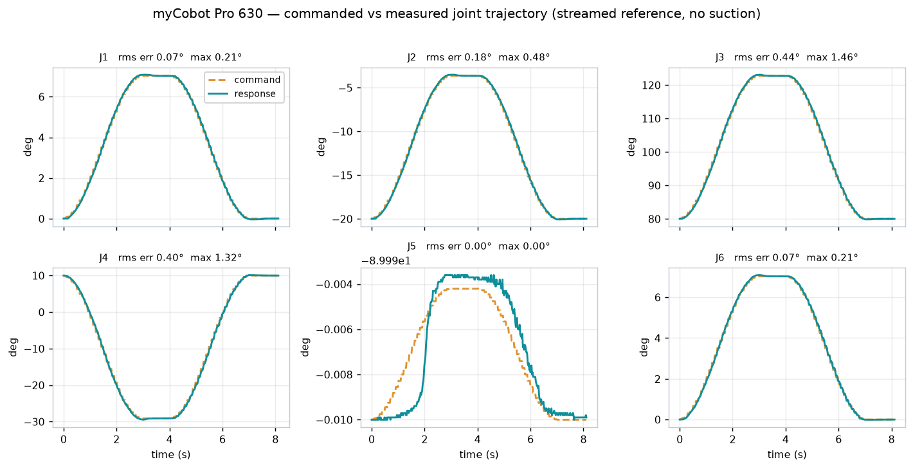
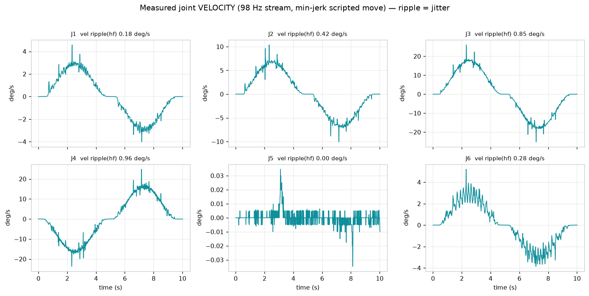
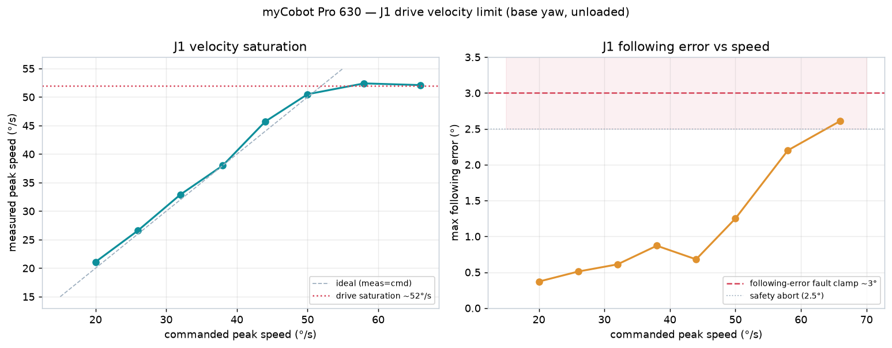
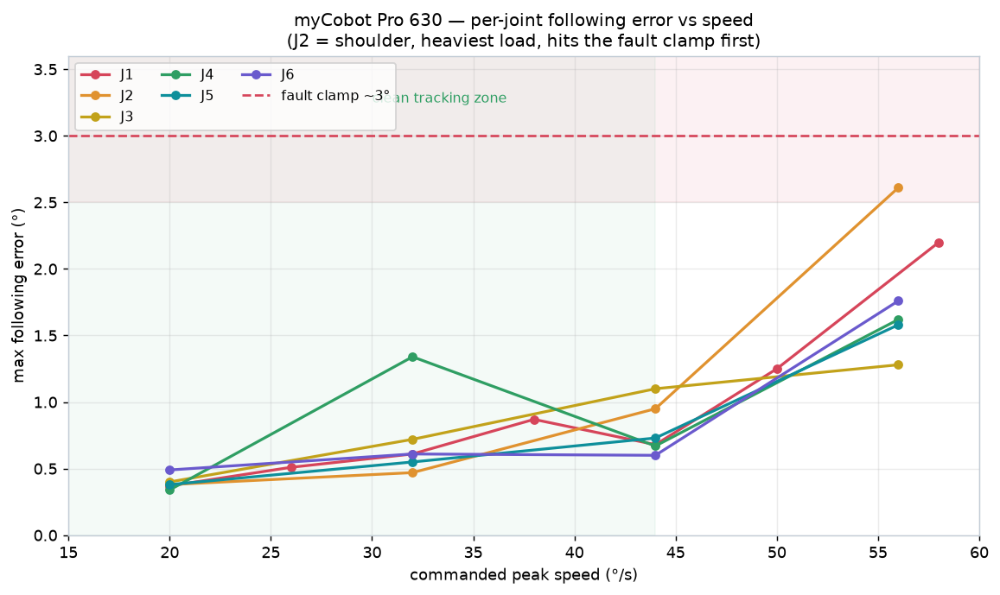

# myCobot Pro 630 — Drive Tracking, Jitter, and Velocity Limits

**Hardware characterization of the Pro 630 under the streamed-reference controller: command-vs-response
tracking, the real source and floor of motion jitter, and the per-joint velocity envelope (where the
drive saturates and where the following-error protection trips).**

Repository: `frankkimrobotics/pick_n_place` · Controller: `rl/real_policy_ctrl.py` (streaming law,
`PiLink`) · Companion: `docs/report-wrench-extraction.md`

All data was taken live on the physical arm through the deployed streaming controller (10 Hz decision
reference, cubic B-spline reconstruction on the Pi, measured velocity-mode drive). Feedback was
harvested at the true ~98 Hz stream rate (de-duplicated by robot timestamp, no polling aliasing).
Every motion was IK- and guard-checked before streaming; velocity-limit sweeps used a live
following-error abort at 2.5° (below the ~3° fault clamp) so the arm never actually faulted.

---

## 1. Command vs response (tracking quality)

A smooth min-jerk free-space move (home → hover → home, no suction) with the commanded reference and
measured joints overlaid.

The streamed reference and the drive's response sit essentially on top of each other. Per-joint RMS
tracking error over a ~50° swing: J1 0.07°, J2 0.18°, J3 0.44°, J4 0.40°, J6 0.07° (max ~1.5° on the
fastest ramp). The small, consistent lag of response behind command is the drive's ~45 ms dead-time,
which the streaming controller's lead term is tuned against. J5 was held constant.

---

## 2. Jitter: what it is, and what does *not* reduce it

The physical jitter observed during motion is **not** visible in position — it lives in velocity.
Below is the measured joint velocity (the smooth bell is the min-jerk reference; the fuzz on top is
the jitter).

**Two separate phenomena are present, and only one is real motion:**

- **Real velocity ripple ≈ 0.7 °/s** (worst on J3/J4). This is the drive's intrinsic velocity-loop
  ripple floor.
- **Feedback-glitch spikes (±20 °/s, single-sample).** These are duplicated/stale telemetry packets,
  *not* physical motion. They dominate any naive ripple metric and scale with sample count, so they
  must be rejected before measuring the real ripple.

### What was tested to reduce it

| Lever | Result |
|-------|--------|
| **Reference density** 10 → 30 → 50 → 100 Hz | **No effect.** Spike-robust ripple flat at ~0.7–1.0 °/s. An early 3-point run suggested a 42% reduction, but that was the glitch artifact — it did not survive a 4-point same-session sweep with a spike-rejected metric. |
| **Move speed** 18 → 10 → 6 °/s | **No effect.** Robust ripple 0.67 / 0.64 / 0.68 °/s on J3 — indistinguishable within ±0.1 run-to-run variance. |

**Conclusion.** The jitter is at the drive's velocity-loop floor and is insensitive to both reference
density and move speed. Neither "easy" software lever moves it. The only remaining lever is
drive-level gain tuning (the streaming law's `K0/K1/vff`, where the one historical win came from —
dropping `K0` 20 → 10 cut ripple ~1.5 → 0.9 °/s), which carries following-error fault risk and was
left as an explicit, separate decision.

---

## 3. Velocity limit (single joint, J1 base yaw)

J1 is collision-free (base rotation, ±360° range), so it was swept to the drive's ceiling. Commanded
peak speed was ramped up while measuring achieved peak speed and following error.

- **Clean tracking to ~50 °/s** — measured follows command with <1.3° following error.
- **Drive saturation ~52 °/s** — commanding 58 or 66 °/s does not increase measured speed; it
  plateaus at ~52 while the reference runs ahead.
- **Following-error fault clamp ~3°** — past saturation the error climbs toward the clamp and the
  firmware would power off. The 2.5° abort prevented an actual fault.

This revises the previously-documented "~36 °/s ceiling": that figure is **not** global — it is
joint- and load-dependent. The unloaded base joint reaches ~52 °/s.

---

## 4. Per-joint velocity envelope (J1–J6)

Each joint was swept over a guard-verified collision-safe range (34° of travel, tool tip kept ≥0.12 m
above the table). Following error — being position-based — is the robust limit indicator (the
peak-velocity estimate is contaminated by the feedback glitches above).

| Joint | Clean to | Saturates ~ | Reaches fault clamp | Notes |
|-------|----------|-------------|---------------------|-------|
| J1 base yaw | ~50 °/s | ~52 °/s | ~58 °/s | lightest; highest ceiling |
| **J2 shoulder** | ~44 °/s | ~50 °/s | **~56 °/s (aborted)** | heaviest gravity load — **limiting joint** |
| J3 elbow | ~44 °/s | ~52 °/s | >56 °/s | good margin |
| J4 wrist | ~44 °/s | ~50 °/s | >56 °/s | |
| J5 wrist | ~44 °/s | ~50 °/s | >56 °/s | |
| J6 wrist roll | ~44 °/s | ~50 °/s | >56 °/s | lightest distal; most margin |

The limiting joint is **J2 (shoulder)**: it carries the most gravity and inertia, so its following
error climbs fastest and it is the first to reach the ~3° fault clamp, near 56 °/s.

---

## 5. Consolidated operating limits

| Limit | Value | Source |
|-------|-------|--------|
| **Safe peak speed, all joints** | **≤ 44 °/s** | following error <1.1° everywhere — design target |
| Drive velocity saturation | ~50–52 °/s | measured plateau |
| Hard ceiling (fault / power-off) | ~55–56 °/s (shoulder); higher on wrist | following-error clamp |
| Following-error fault clamp | ~3° | robot_hal / firmware protection |
| Velocity ripple floor | ~0.7 °/s | speed- & density-independent |
| Command → motion dead-time | ~45 ms | drive + CAN |
| Joint ranges | J1/J2 ±360°, J3 ±160°, J4–J6 ±180° | config |
| Task elbow box (guard) | \|J2\| ≤ 70°, \|J3\| ≤ 145° | `real_policy_ctrl.Guard` |

**Practical note for the policy.** The deployed policy runs at a 32 °/s action clamp — comfortably
inside the clean-tracking band on every joint, with real headroom to ~44 °/s if faster motion is ever
wanted. As established separately, the pick cycle is gated by the seal-safe press and carry phases,
not by this velocity limit.

---

*Generated as part of the pick_n_place program. Method: live measurement through
`rl/real_policy_ctrl.py` with 98 Hz feedback harvesting and a 2.5° following-error safety abort.*
