# runlog: one MCAP per robot run

Design for a messaging layer that records every real Pro 630 run (images, depth, joint feedback,
torque, commands, acks, suction, policy decisions, events) into a single timestamped `.mcap`, so any
run can be replayed, plotted in Foxglove, or converted to a dataset later.

Status: design, 2026-11-25. Nothing below is implemented yet except where marked *exists*.
Diagram in section 3 is authored with [archify](https://github.com/tt-a1i/archify).

---

## 1. What exists today, and why it is not enough

| source | rate | where it goes now | problem |
|---|---|---|---|
| Pi feedback `:9999` `{joints_deg[6], timestamp}` | 100 Hz | `PiLink.samples` ring buffer (400) | not saved; torque is in the parsed field but the repo copy of `robot_hal.py` does not send it |
| Pi per-tick controller log (`q, qvel, target, cmd_pos, cmd_vel, u, hal_vel, hal_torq, loop timing`) | 100 Hz | CSV on the Pi, fetchable with a `log` command | never fetched during policy runs |
| commands `:9998` (`chunk`/`spline`, `t_anchor`, `seq`, `tag`, gains) and acks | ~5-10 Hz | sent and forgotten | the exact command stream is unrecoverable afterwards |
| suction `{"suction": 0/1}` | events | `steps.jsonl` has the state per decision | the switch instant is lost between decisions |
| wrist D405 colour 424x240, depth 16UC1, ZED colour 432x240, ZED XYZ 180x320 f16, fixed D405 | 15 fps (XYZ 5 fps) | `/dev/shm` files, overwritten in place | `cam_record3.py` copies colour only, as 30 000 JPEG files + `frames.csv`, 860 MB per run, on its own clock |
| executor decision record (`k, t, q_meas, q_cmd, tip, tgt, tau, suction, suc_pred, hold, clips, plan, lead`) | ~6 Hz | `steps.jsonl` + `obs_NNN_*.jpg` | fine, but separate from everything above |
| phases / aborts / verify outcomes | events | `print()` | gone when the terminal scrolls |
| `episode_bag.py` MCAP writer (*exists*) | | used only by `servo_touch.py` | needs a running ROS node and ROS topics the executor does not publish |

Three clocks are in play: host wall time, the Pi's wall time (unsynchronised; `PiLink` estimates the
offset as `min(t_recv - t_pi)` over the stream, about 1 to 2 ms on the direct cable), and camera
publish time, which is host time at the moment `zed_cam_server` wrote the file, not the sensor capture
time. Nothing records these relationships, so they cannot be corrected offline.

A side finding from reading `/dev/shm` while writing this: the ZED stamp was 6.8 hours older than the
wrist stamp, so the ZED thread of the running `zed_cam_server` is stuck. A recorder with a liveness
check would have reported that at the start of the next run instead of after it.

## 2. Requirements

1. Every run that moves the arm produces exactly one `.mcap`, without the operator remembering to start anything.
2. Every message carries two times: when the source produced it and when the recorder received it.
3. Recording never blocks or slows the control loop; if the recorder dies, the run continues.
4. Files open in Foxglove Studio unchanged and feed `il/data/bags_to_dataset.py` unchanged.
5. No ROS at runtime for the executor. ROS message *schemas* are fine; a ROS *node* is not.
6. A run's provenance travels with the file: arguments, checkpoint, git commit, calibration.

## 3. Architecture



Interactive version: [`runlog_architecture.html`](runlog_architecture.html) (archify, source
`runlog_architecture.architecture.json`; regenerate with
`node archify/bin/archify.mjs deliver architecture docs/runlog_architecture.architecture.json docs/runlog_architecture.html`).

**One writer.** A separate `runlog.Recorder` process owns the MCAP file. Two writers to one MCAP is not
possible, and putting the writer inside the executor would tie the file to that process and duplicate
camera tailing in every script.

**Automatic start.** `PiLink.__init__` spawns the recorder (`subprocess.Popen`, detached) unless
`RUNLOG=0`. **The run id is the timestamp**, `YYYYmmdd_HHMMSS_mmm` in host local time with milliseconds
(for example `20261125_143012_417`), and the file is `~/pnp_runs_mcap/<run_id>.mcap`. The script name,
arguments and checkpoint go in the MCAP metadata record, not in the id, so files sort by time and
the id is the same thing every log line, the Pi CSV and the Pi agent use to refer to the run. `PiLink.close()` and the SIGINT handler send `stop`.
That single hook covers all eight PiLink scripts: `real_rollout_zed`, `real_policy_ctrl`,
`real_wrench_ctrl`, `edge_calib`, `planner_touch`, `side_calib`, `touch_verify`, `wrist_centre`.
`servo_touch` and `vision_touch` keep `episode_bag.py` until it is retired in phase 4.

**Non-blocking publish.** `runlog.Publisher.send(topic, dict | bytes, t_src)` writes one datagram to
`/run/user/<uid>/runlog.sock`. Datagram sockets drop when the receiver is behind; the executor never
waits. Images are not sent this way: the recorder tails `/dev/shm` itself at the server's rate.

**Feedback at full rate.** The recorder opens its own connection to the Pi `:9999` stream (`robot_hal`
accepts multiple clients), so joint feedback is logged at 100 Hz regardless of what the executor
samples. The executor's own view is still logged through its decision records.

**Writer thread.** Inside the recorder, a queue feeds one thread that writes MCAP chunks with zstd
compression. Camera tailing, the Pi stream client, and the datagram listener are three producer
threads. Chunk size 4 MB, index on close.

## 4. Message catalogue

Times: `log_time` = recorder receipt, host wall clock. `publish_time` = source time converted to host
time (`t_pi + clock_offset` for Pi data; the `/dev/shm` stamp for images; `time.time()` at creation for
executor records). Both are stored per message by MCAP.

ROS 2 schemas (so Foxglove and `rosbags` read them natively), written with `mcap_ros2` + the
`rosbags` typestore, which needs no ROS installation at runtime:

| topic | type | rate | notes |
|---|---|---|---|
| `/camera/color/image_raw` | `sensor_msgs/CompressedImage` jpeg | 15 Hz | wrist D405, name kept for `bags_to_dataset.py` |
| `/camera/depth/image_raw` | `sensor_msgs/Image` 16UC1 mm | 15 Hz | wrist D405 depth, 203 KB raw per frame, zstd takes it to about 60 KB |
| `/camera/color/camera_info` | `sensor_msgs/CameraInfo` | once | from `pnp_wrist_intr.json` |
| `/cam/zed/color` | `CompressedImage` jpeg | 15 Hz | 432x240, the policy's input |
| `/cam/zed/xyz` | `sensor_msgs/Image` 32FC3 | 5 Hz | the decimated cloud as an image, 180x320x3, 0.7 MB raw |
| `/cam/fixed/color` | `CompressedImage` jpeg | 15 Hz | fixed D405 when present |
| `/joint_states` | `sensor_msgs/JointState` | 100 Hz | position rad, velocity (Pi), effort = torque proxy |
| `/mycobot/suction` | `std_msgs/Bool` | on change | written at the instant `PiLink.suction()` sends |
| `/phase` | `std_msgs/String` | events | same role as `episode_bag.write_phase` |

JSON schema topics (MCAP `jsonschema` encoding; Foxglove shows them in the raw-message and plot
panels) for records that have no sensible ROS type:

| topic | content |
|---|---|
| `/robot/cmd` | the exact dict sent to `:9998`, plus `t_send_host` |
| `/robot/ack` | the ack dict and host receipt time |
| `/clock/pi` | `{t_recv, t_pi, offset_est}` at 1 Hz, so the offset can be re-fitted offline |
| `/policy/decision` | the `steps.jsonl` record, unchanged |
| `/policy/plan` | adopted action chunk, `k_obs`, inference latency |
| `/event` | `{level, text}`: every `[abort]`, `[verify]`, `[splice]`, `[contact]` print |
| `/pi/hal_tick` | rows of the Pi's per-tick CSV, inserted at stop with Pi timestamps |
| `/recorder/health` | per-source liveness and queue depth at 1 Hz; a stuck camera shows up here |

Attachments (MCAP attachments, bytes with a name): `args.json`, the Pi CSV verbatim, `extrinsics_zed.json`
and the hand-eye file, `git rev-parse HEAD` + `git diff` of the repo. Metadata record: run id (the timestamp), script,
checkpoint path and sha256, hostname, env name, container and box geometry if known.

## 5. Clocks

1. **Now**: record `t_recv` and `t_pi` for every feedback sample and the running `clock_offset`. That
   makes the Pi clock recoverable offline even though it is not synchronised.
2. **Phase 3**: run `chrony` on the Pi with the host as its server over the direct cable. Sub-millisecond
   agreement, one-time setup, and `clock_offset` becomes a check rather than a correction.
3. **Phase 3**: stamp camera frames with sensor capture time: ZED `get_timestamp(TIME_REFERENCE.IMAGE)`,
   D405 `frame.get_timestamp()`. Today's stamps are publish times, so the 70 to 90 ms camera latency the
   twin assumes cannot be measured from the logs.
4. The Pi stream packet gains `seq` and `torque` (the host already parses both; the repo copy of
   `robot_hal.py` sends neither).

## 6. Storage budget

Per run at 15 fps, all three cameras, depth and cloud included:

| stream | per second | 10 min run |
|---|---|---|
| three colour JPEGs, 24 to 33 KB each | 1.3 MB | 0.75 GB |
| wrist depth, zstd about 3:1 | 1.0 MB | 0.6 GB |
| ZED cloud at 5 Hz, zstd about 2:1 | 0.9 MB | 0.5 GB |
| feedback, commands, decisions, events | under 50 KB | under 30 MB |

Roughly 1.9 GB per ten-minute run with everything on, against 0.86 GB today for colour only as
loose files. Flags: `--depth 5` (depth at 5 fps, 0.2 GB), `--no-cloud`. The disk review of 23 Nov left
498 GB free; a per-run budget of about 2 GB is fine, but `~/pnp_runs_mcap` should be on the list the
next time space is reviewed.

## 7. API the scripts see

```python
from runlog import bus                     # module-level singleton, no-op when RUNLOG=0 or recorder absent
bus.event("contact", tau=0.113)            # -> /event
bus.decision(rec)                          # -> /policy/decision  (replaces log_f.write(json.dumps(rec)))
bus.plan(chunk, k_obs=k, latency=lat)      # -> /policy/plan
bus.attach("args.json", json.dumps(vars(a)))
```

Inside `PiLink`, no change for callers:

```python
def _send(self, cmd):           ... ; bus.cmd(cmd)                     # after sendall
def suction(self, on):          ... ; bus.suction(on)
def _cmd_loop(self):            ... ; bus.ack(m)                       # on every ack line
def __init__(...):              bus.start(run_id, pi=host) ; ...        # spawns the recorder
def close(self):                ... ; bus.stop()                       # fetches the Pi log, runs check
```

`steps.jsonl` keeps being written for one release so nothing downstream breaks; it is removed once
`bags_to_dataset.py` reads `/policy/decision`.

## 8. Verification: `runlog check <file>`

Runs automatically at stop and prints one block; fails loudly, never silently:

```
run 20261125_143012_real_rollout_zed   412.3 s   1.71 GB
topic                      msgs    rate    gaps>2x   first..last
/joint_states             41180  99.9 Hz       0    0.00..412.3
/camera/color/image_raw    6177  15.0 Hz       2    0.21..412.2
/cam/zed/color             6180  15.0 Hz       0    ...
/robot/cmd                 2104   5.1 Hz       -    ...
/mycobot/suction              7       -        -    ...
clock: pi offset 1.4 ms, drift 0.02 ms/min
health: zed stale for 0.0 s (max), wrist 0.1 s
attachments: args.json, robot_hal_policy.csv, extrinsics_zed.json, git.diff
```

The "gaps" column is the check that would have caught the stuck ZED thread, and the rate column is
the check that would have caught a recorder that silently fell behind.

## 9. Rollout

| phase | work | effort |
|---|---|---|
| 1 | `runlog/` package: `Publisher`, `Recorder` (shm tail + Pi stream + datagram listener + writer thread), `check`; `PiLink` hook; `pip install mcap mcap-ros2-support rosbags` into `ilpolicy`; `runlog-pi` agent (halsampler, error channel, candump, stdout handler) | 1.5 days |
| 2 | executor: `bus.decision/plan/event` calls beside the existing prints and `steps.jsonl`; attachments | half a day |
| 3 | Pi: `seq` + `torque` in the stream packet, `chrony`, `log` fetch at stop; cameras: sensor capture stamps | half a day, needs the robot |
| 4 | Foxglove layout file in the repo; `bags_to_dataset.py` reads `/policy/decision`; retire `cam_record3.py` and `episode_bag.py` | half a day |

Phase 1 alone satisfies requirement 1: from then on every PiLink run leaves an MCAP with full-rate
feedback, every command, every suction switch, and all camera streams, whether or not the executor
publishes anything.

## 10. Decisions made, and why

- **Separate recorder process, not an in-process writer.** The run must survive a recorder crash,
  and camera tailing should exist once, not per script.
- **Datagram socket for executor messages.** Drops under backpressure instead of blocking a 10 Hz
  control loop. Images never take this path.
- **ROS 2 schemas without ROS.** `mcap_ros2` plus the `rosbags` typestore generates the message
  definitions from a table; verified working in system Python with no node. Foxglove and the existing
  dataset converter get standard types; the executor keeps its no-ROS environment.
- **JSON for commands and decisions.** They are dicts already; inventing ROS messages for them would add
  a build step and buy nothing.
- **Topic names of the existing consumer preserved** (`/camera/color/image_raw`, `/joint_states`,
  `/mycobot/suction`, `/phase`) so `bags_to_dataset.py` works on day one.
- **Recorder also reads the Pi stream directly** rather than relaying through the executor, so
  feedback is logged at 100 Hz even when the executor samples at 6 Hz.

## 11. Transport: zenoh, not iceoryx2

The question came up whether the messaging layer should be iceoryx2 or zenoh. For this system the
answer is zenoh, for one decisive reason and three supporting ones.

**Decisive: this is a two-host system.** The executor and cameras are on the desktop; `robot_hal`,
LinuxCNC and the drives are on the Pi, joined by a direct Ethernet cable. iceoryx2 is shared-memory
IPC for processes on one machine; crossing to the Pi would still need a second transport (today's
hand-rolled TCP JSON lines, or a gateway). zenoh is a network pub/sub from the start, with a
shared-memory path for same-host subscribers, so one API covers desktop-internal traffic and the
desktop-to-Pi hop. Adopting iceoryx2 would mean running two messaging systems to replace one.

Supporting:

1. **Python on both ends.** The executor, camera server and `robot_hal` are Python. zenoh ships
   mature Python bindings (`eclipse-zenoh` on PyPI, aarch64 wheels for the Pi's pyenv 3.10).
   iceoryx2's core and first-class bindings are Rust, C and C++; its Python bindings are newer
   and would need verifying on the Pi before committing to them.
2. **Throughput is modest.** About 1.3 MB/s of JPEG, 3 MB/s of depth, 100 Hz of 200-byte feedback.
   Zero-copy is iceoryx2's advantage and it is not needed at these rates; zenoh over loopback or
   its shared-memory mode handles this with margin.
3. **It is the direction ROS 2 went.** `rmw_zenoh` is the alternative ROS 2 middleware, so a zenoh
   topic layout maps cleanly onto ROS 2 schemas in MCAP and onto Foxglove, which this design
   already relies on.

What changes in the design if zenoh is adopted: the three ad hoc transports collapse into one.
`robot_hal` publishes feedback on `robot/joint_states` instead of serving a TCP line stream (and the
stream-thread failure mode that leaves CLOSE-WAIT sockets goes away); `zed_cam_server` publishes
frames instead of overwriting `/dev/shm` files; `PiLink` publishes commands, acks and suction on
`robot/cmd`, `robot/ack`, `robot/suction`; the recorder becomes a plain subscriber that writes
every key it hears into MCAP. Best-effort publishers with congestion-control drop give the same
non-blocking guarantee the datagram socket was chosen for, and zenoh's source timestamps complement,
but do not replace, the explicit `t_src` fields in each payload.

What does not change: single writer, automatic start from `PiLink`, the message catalogue, clocks,
`runlog check`. Phase 1 as written needs no new dependency on the Pi; swapping the datagram and
`/dev/shm` paths for zenoh is a contained change that can land in phase 2 or 3 once it has been
tried on the Pi.

The case for iceoryx2 would be a future single-host pipeline moving uncompressed high-resolution
depth or point clouds at 30 fps or more between several processes. That is not this system.

## 12. Everything from the Pi and the drives: the `runlog-pi` agent

The recorder on the desktop can only save what reaches it. Today most of what the Pi and the drive
controllers produce never leaves the Pi, so phase 1 adds a small agent on the Pi, `runlog-pi`, that
streams every source below to the desktop recorder, each line stamped with Pi time and a sequence
number, and the recorder adds its receipt time. Sources, what they contain, and how they are tapped:

| source | what it carries | how `runlog-pi` taps it | topic |
|---|---|---|---|
| `pro600` HAL pins, all of them | per joint `posfb`, `poscmd`, `motor_poscmd`, `velfb`, `torqfb`, `colli_res`, `pos_lim`/`neg_lim`; global `poweron`, `svr_enabled`, `svr_poweroned`, `svr_en`, `motion_enabled`, `collidet_res`, `motor_time_interval`, `motor_accelaration` | LinuxCNC `sampler` realtime component on the servo thread + `halsampler`: lossless at 100 Hz, no polling | `/pi/hal_pins` |
| LinuxCNC error channel | NML errors and operator messages: following error, joint faults, the firmware's "Position cmd and fb are too far apart" and the resulting Power OFF | `linuxcnc.error_channel().poll()` loop | `/pi/nml_error` |
| CAN bus `can0` | every frame to and from the STM32 drive boards, including status words (`0x8637`, `0x8237` seen in August) and error frames; the only place the drives' own state is visible | `candump -e -t a can0`, parsed per line | `/can/frames` |
| CAN interface counters | TX/RX counts, error-passive and bus-off transitions, restarts; the August "deaf drives" signature was a frozen TX counter | `ip -s -d link show can0` at 1 Hz | `/can/stats` |
| `robot_hal` stdout and stderr | every print: queue waits, gains applied, `Log saved`, tracebacks; today these go to the terminal that launched LinuxCNC (`loadusr -Wn ctrl python robot_hal.py`) | a `logging` handler in `robot_hal` that also writes lines to the agent's socket; no change to the prints | `/pi/robot_hal` |
| `pro600` component debug output | `bus write 0x206: error!!!` and similar CAN-layer messages | captured from the LinuxCNC launcher's stdout (`linuxcnc.log` when started with logging, or a `script` wrapper around the launch) | `/pi/pro600` |
| `:9998` status replies | `state`, `current_deg`, `target_deg`, `error_norm`, `last_log_name` and extras | the recorder's own polling client, 10 Hz | `/robot/status` |
| `:9998` acks and `log` replies | ack dicts; the base64 CSV reply | already in the design | `/robot/ack`, `/pi/hal_tick` |
| kernel ring buffer | `can0` link up/down, USB resets, undervoltage warnings | `dmesg -w` filtered to `can0`, `usb`, `voltage`, `throttl` | `/pi/kernel` |
| system state at start and stop | `uptime`, CPU temperature and throttling flags, `ip link`, running vendor processes (RoboFlow, elephantmonitor), `halcmd show pin pro600` | snapshot commands at start and stop | attachments `pi_start.json`, `pi_stop.json` |
| per-tick controller CSV | the 100 Hz `q, qvel, target, cmd, u, hal_vel, hal_torq, loop timings` rows | fetched at stop through the existing `log` command | `/pi/hal_tick` + attachment |

Transport from the Pi to the desktop: in phase 1 a line stream on `:9997` (same shape as the feedback
stream, one JSON object per line, `{run_id, seq, t_pi, src, payload}`), replaced by zenoh keys under
`pi/**` when zenoh lands. The agent is started by the recorder over SSH at run start with the run id
as its argument, and told to stop at run end; if it cannot be started, the recorder refuses to start
the run rather than silently recording a desktop-only file.

Budget: `candump` at the 10 ms exchange rate is about 1,200 frames per second, under 100 KB/s as text;
`/pi/hal_pins` at 100 Hz with 50 pins is about 40 KB/s. The Pi-side total is well under 1 MB/s.

**Nothing is optional.** `runlog check` carries the list of required sources above and reports any
source that produced zero messages, or stopped before the run ended, as a failure, so a run with a
missing Pi stream fails loudly instead of looking complete.
